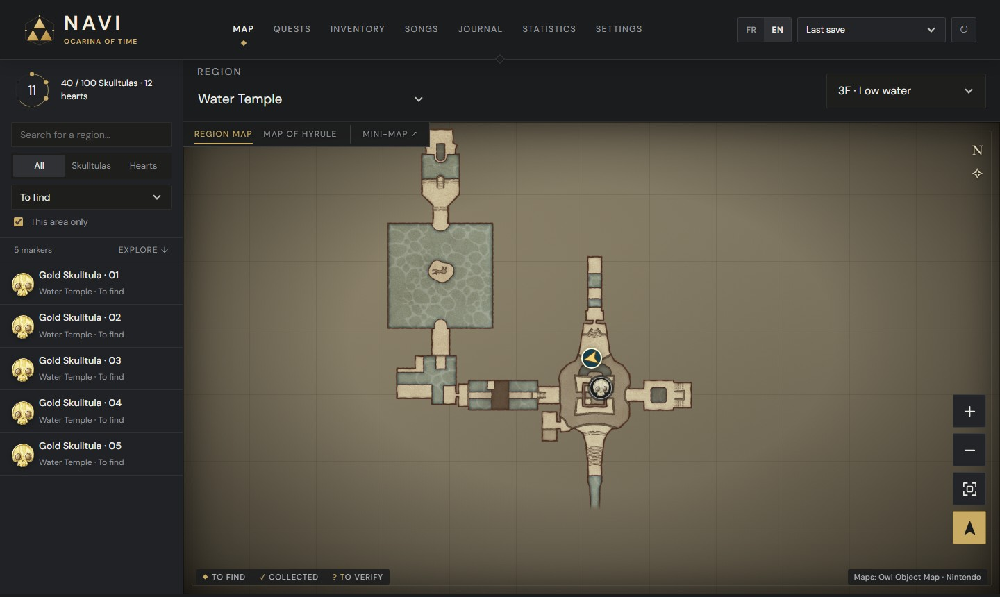
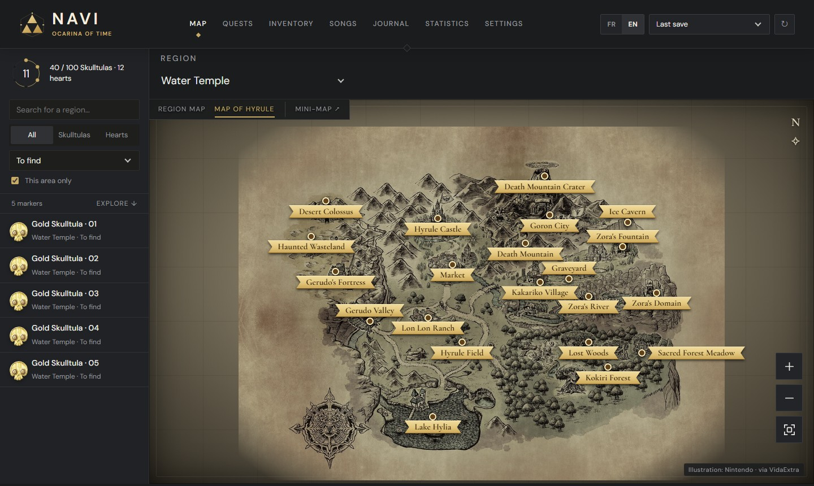
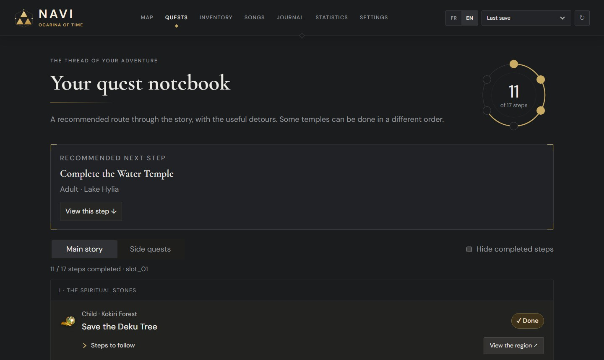
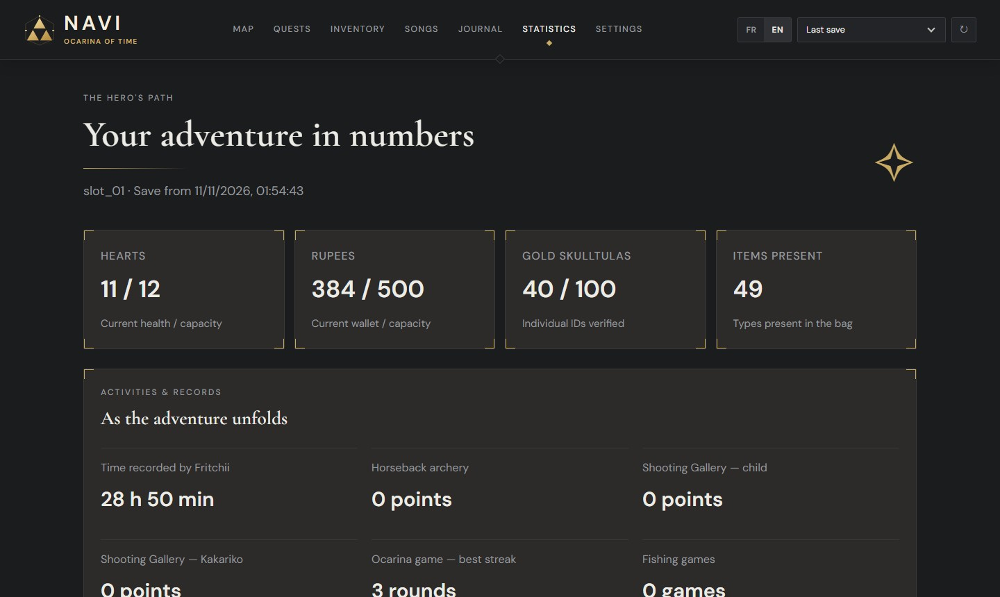

# Navi — a companion for Ocarina of Time on Fritchii

Navi is an unofficial, local companion to keep open next to the game. It reads your Fritchii saves (read-only) and shows:

- the map of Hyrule and the dungeon floor plans, with Link's position;
- the 100 Gold Skulltulas and the 36 Pieces of Heart, collected or remaining;
- quest progress, inventory, songs and a few statistics;
- a floating mini-map that stays on top of the game.

The interface is available in **English and French** (switch at the top right).





| Quests | Statistics |
| --- | --- |
|  |  |

Everything runs on your PC: the server only listens on `127.0.0.1` and none of your data is sent anywhere. Navi only reaches the Internet to download the game images on first launch and to ask GitHub whether a newer version exists.

## Installation

Nothing to install first: everything Navi needs is in the archive (about 10 MB).

1. Download `Navi-companion.zip` from the [Releases](../../releases/latest) page and unzip it.
2. Put the `Navi-companion` folder **inside the Fritchii folder** (where `fritchii.exe` is) or right next to it.
3. Double-click `Navi.exe`.

Navi opens in its own window. On first launch, the launch screen shows the download of about 210 game images (icons and maps, 17 MB). Save once in the game for your data to appear. Closing the window stops Navi.

Windows may show "Windows protected your PC" because the files are not signed: click **More info**, then **Run anyway**.

Requirements: Windows 10 or 11, 64-bit, with Microsoft Edge WebView2 (included in Windows 11 and in up-to-date Windows 10).

### Updates

At launch, Navi asks GitHub whether a newer release exists and shows a banner if so. **Update** downloads the release with a progress bar, replaces the program files and restarts Navi; your `config.json`, downloaded images and notes are kept. **Later** hides the banner until the next release.

To turn the check off, add `"check_updates": false` to `config.json`.

### If Navi cannot find your saves

Copy `config.example.json` to `config.json` and set the game's save folder in it, for example:

```json
{
  "save_root": "D:\\Games\\Fritchii\\user\\nand\\user\\save\\0000000000000000\\YOUR_PROFILE\\0400486024DEC000"
}
```

## Mini-map on top of the game

Click **Mini-map** from the map, or run `Start-Navi-Overlay.cmd`. The mini-map starts Navi by itself if needed.

- Play in windowed or borderless fullscreen mode, otherwise the game covers it.
- Move it with the golden handle on the top edge; resize it from the edges and corners.
- `Ctrl+Alt+N` locks or unlocks clicks (when locked, clicks go through to the game).
- `Ctrl+Alt+M` hides or shows it. The Navi icon near the clock offers the same actions and the language switch.
- Both shortcuts work from anywhere, the game included. With only the Navi window open, they open the mini-map.

## Live tracking

When **Last save** is selected and the game is running, Navi reads Link's position and the state of some quests straight from the emulator's memory — read-only, with no injection and no change to the game. An antivirus may flag this.

Live tracking targets 64-bit Windows and game version **1.1.1**. With another version, Navi falls back to the last saved position.

## Limits

- No editing features: Navi never modifies the game or the saves.
- Pieces of Heart are only partly synchronised; those marked "To verify" are not necessarily missing.
- Notes are stored in your browser: use the export to keep them.

More details in [docs/DETAILS.md](docs/DETAILS.md).

## From source

With Python 3.9+ installed, `Start-Navi.cmd` runs the server from the sources and opens Navi in your browser.

| Folder | Content |
| --- | --- |
| `src/` | Python server: save reading, live tracking, image download, updates |
| `web/` | Interface served to the window: page, script, styles, English texts, fonts |
| `data/` | Game reference tables: catalogue, collectibles, floor plans, image sources |
| `app-src/` | The window (`Navi.exe`): a small .NET Framework 4.8 program using WebView2; `Navi.exe --overlay` is the mini-map |
| `maps/`, `assets/` | Game images, downloaded at first launch (only the fairy fountain plans are in the repository) |
| `tests/`, `tools/`, `docs/` | Tests, build and checks, documentation |

To build the release archive (Python with PyInstaller, .NET SDK 8 or newer, git):

```
powershell -ExecutionPolicy Bypass -File tools\build.ps1
```

This produces `dist/Navi-companion.zip` with `Navi.exe` and `server\navi-server.exe` (embedded Python). The version number is in the `VERSION` file.

Tests:

```
python -m unittest discover -s tests -t .
node tests/test_collectibles.cjs
```

Before contributing, enable the checks that keep personal paths, settings, build output and game images out of the repository (they run before each commit and push, and on the release archive):

```
git config core.hooksPath .githooks
```

French is the source language of the interface; English texts live in [web/i18n.js](web/i18n.js).

## Credits and licences

- Navi source code: MIT licence, see [LICENSE](LICENSE).
- Save format and catalogue adapted from [Traiver/OOT-SW2SE](https://github.com/Traiver/OOT-SW2SE) (MIT, see [LICENSE-Traiver.txt](docs/LICENSE-Traiver.txt)).
- Memory layouts documented by [PracticeROM/sloperina](https://github.com/PracticeROM/sloperina) and [Kabosune/oot-remake-modding](https://github.com/Kabosune/oot-remake-modding).
- Maps and positions: [Owl Object Map](https://objmap-oot.zeldamods.org/). Icons: [Zelda Central](https://zeldacentral.com/). The full list is in [ASSETS-SOURCES.txt](docs/ASSETS-SOURCES.txt) and [images-sources.json](data/images-sources.json).
- Cormorant Garamond and DM Sans fonts: SIL Open Font License 1.1.

The Legend of Zelda, Ocarina of Time and their artwork belong to Nintendo. This project is not affiliated with or endorsed by Nintendo, and contains neither the game nor its files.
