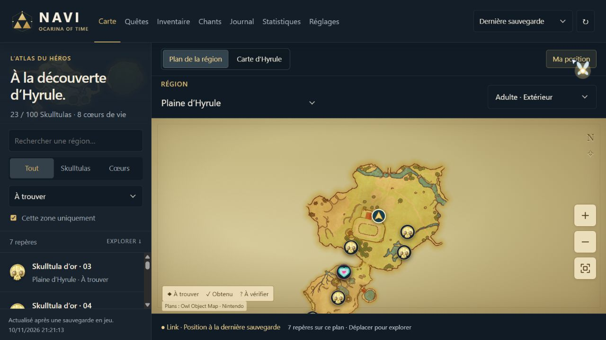
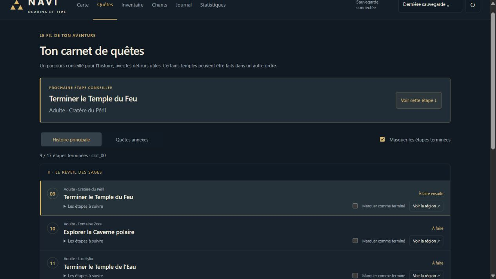

# Navi — compagnon pour Ocarina of Time sur Fritchii

Navi est un compagnon local, non officiel, à garder ouvert à côté du jeu. Il lit vos sauvegardes Fritchii (en lecture seule) et affiche :

- la carte d'Hyrule et les plans des donjons, avec la position de Link ;
- les 100 Skulltulas d'or et les 36 fragments de cœur, trouvés ou restants ;
- l'avancement des quêtes, l'inventaire, les chants et quelques statistiques ;
- une mini-carte flottante qui reste au-dessus du jeu.



| Quêtes | Statistiques |
| --- | --- |
|  |  |

Tout fonctionne sur votre PC : le serveur n'écoute que sur `127.0.0.1` et rien n'est envoyé à un service externe. Le seul accès à Internet est le téléchargement des images du jeu au premier lancement.

## Installation

1. Installez [Python 3](https://www.python.org/downloads/) (3.9 ou plus récent).
2. Téléchargez l'archive `Navi-companion.zip` depuis la page **Releases** de ce dépôt et décompressez-la.
3. Placez le dossier `Navi-companion` **dans le dossier de Fritchii** (là où se trouve `fritchii.exe`) ou juste à côté de lui.
4. Double-cliquez sur `Lancer-Navi.cmd`.

Au premier lancement, Navi télécharge environ 210 images (icônes et plans, 17 Mo), puis ouvre `http://127.0.0.1:8766` dans votre navigateur. Sauvegardez une fois en jeu pour que vos données apparaissent.

Windows peut afficher « Windows a protégé votre ordinateur » parce que les fichiers ne sont pas signés : cliquez sur **Informations complémentaires**, puis **Exécuter quand même**.

### Si Navi ne trouve pas vos sauvegardes

Copiez `config.example.json` en `config.json` et indiquez-y le dossier de sauvegarde du jeu, par exemple :

```json
{
  "save_root": "D:\\Jeux\\Fritchii\\user\\nand\\user\\save\\0000000000000000\\VOTRE_PROFIL\\0400486024DEC000"
}
```

## Mini-carte au-dessus du jeu

Lancez `Lancer-Navi-Flottant.cmd`, ou cliquez sur **Sur le jeu** depuis la carte. La mini-carte démarre Navi toute seule si besoin.

- Elle demande [.NET Desktop Runtime](https://dotnet.microsoft.com/download/dotnet) 8 ou plus récent (x64) et Microsoft Edge WebView2, déjà présent sur Windows 11.
- Jouez en mode fenêtré ou plein écran sans bordure, sinon le jeu la recouvre.
- Déplacez-la par la poignée dorée du bord supérieur ; redimensionnez-la par les bords et les coins.
- `Ctrl+Alt+N` verrouille ou déverrouille les clics (verrouillée, les clics passent au jeu).
- `Ctrl+Alt+M` la masque ou l'affiche. L'icône Navi près de l'horloge propose les mêmes actions.

## Suivi en direct

Quand **Dernière sauvegarde** est sélectionnée et que le jeu tourne, Navi lit la position de Link et l'état de certaines quêtes directement dans la mémoire de l'émulateur, en lecture seule, sans injection ni modification du jeu. Un antivirus peut le signaler.

Le direct est prévu pour Windows 64 bits et la version **1.1.1** du jeu. Avec une autre version, Navi revient à la dernière position sauvegardée.

## Limites

- Aucune fonction d'édition : Navi ne modifie ni le jeu ni les sauvegardes.
- Les fragments de cœur ne sont que partiellement synchronisés ; ceux marqués « À vérifier » ne sont pas forcément manquants.
- Le catalogue d'inventaire est en partie en anglais.
- Les notes sont enregistrées dans votre navigateur : utilisez l'export pour les conserver.

Le détail du fonctionnement est dans [docs/DETAILS.txt](docs/DETAILS.txt).

## Depuis les sources

Le dépôt ne contient pas la mini-carte compilée. Pour la construire (SDK .NET 8 ou plus récent) :

```
dotnet publish overlay-src/NaviOverlay.csproj -c Release -o overlay-app
```

Tests :

```
python -m unittest discover -p "test_*.py"
node test_collectibles.cjs
```

## Crédits et licences

- Code de Navi : licence MIT, voir [LICENSE](LICENSE).
- Format des sauvegardes et catalogue adaptés de [Traiver/OOT-SW2SE](https://github.com/Traiver/OOT-SW2SE) (MIT, voir [LICENSE-Traiver.txt](LICENSE-Traiver.txt)).
- Dispositions mémoire documentées par [PracticeROM/sloperina](https://github.com/PracticeROM/sloperina) et [Kabosune/oot-remake-modding](https://github.com/Kabosune/oot-remake-modding).
- Plans et positions : [Owl Object Map](https://objmap-oot.zeldamods.org/). Icônes : [Zelda Central](https://zeldacentral.com/). La liste complète est dans [ASSETS-SOURCES.txt](ASSETS-SOURCES.txt) et [images-sources.json](images-sources.json).
- Polices Cormorant Garamond et DM Sans : SIL Open Font License 1.1.

The Legend of Zelda, Ocarina of Time et leurs visuels appartiennent à Nintendo. Ce projet n'est ni affilié à Nintendo ni approuvé par Nintendo, et ne contient ni le jeu ni ses fichiers.
